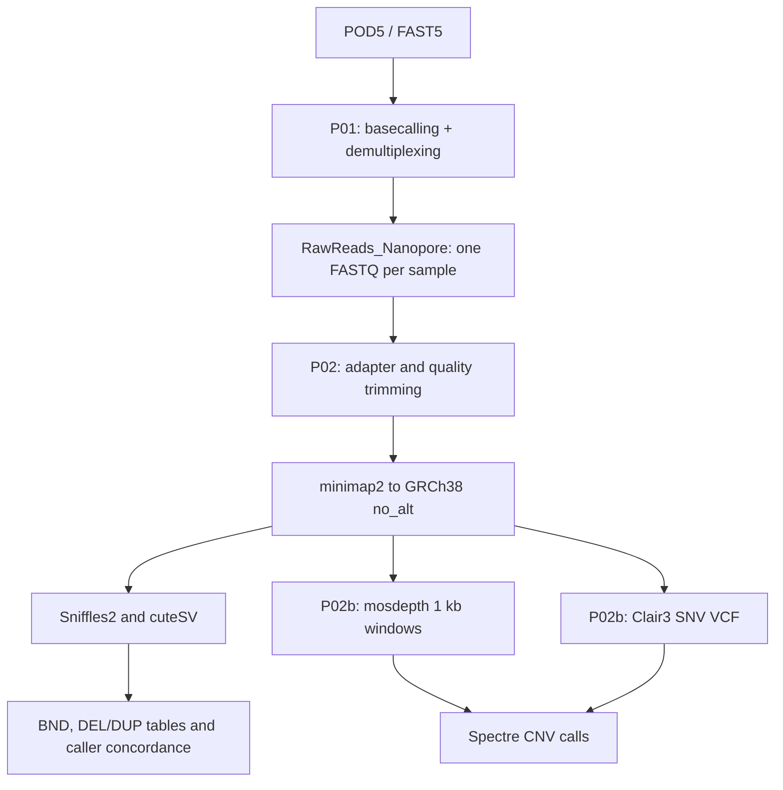

# HumanGenetic ONT pipeline: basecalling, structural variants, SNV and CNV

SLURM scripts for the analysis of Oxford Nanopore (ONT) whole-genome human data on the CRIANN HPC cluster. The pipeline goes from raw signal (POD5) to basecalled and demultiplexed reads, then to structural variants (SV, including inter-chromosomal translocations), small variants (SNV/indels) and copy-number variants (CNV).

**Author:** Nicolas Nesi, University of Caen Normandy, DYNAMICURE INSERM UMR 1311
**Version:** v1.0 (October 2026)

| Script | Purpose | Type | Main tools |
|---|---|---|---|
| `P01_Basecalling.sh` | Basecalling, demultiplexing, adapter/barcode trimming, run QC | single job (GPU) | Dorado (or Guppy), PycoQC |
| `P02_MappingCNVSV.sh` | Read cleaning, mapping, SV calling, translocation and DEL/DUP tables | job array (1 task per sample) | porechop_abi, fastp, nanoq, minimap2, Sniffles2, cuteSV, SURVIVOR, bcftools |
| `P02b_Clair3.sh` | Coverage, SNV calling, CNV calling | job array (1 task per sample) | mosdepth, Clair3, Spectre |

## Workflow



## Requirements

* SLURM cluster with a GPU partition (P01) and CPU nodes (P02, P02b). Partition names, resources and paths are set in the `#SBATCH` header and in the variables section of each script; adapt them to your site.
* A node-local scratch directory exposed as `LOCAL_WORK_DIR` (each job works there and copies results back at the end).
* Singularity for Clair3 (image `clair3_latest.sif`).
* Software (versions used):

| Environment | Tools |
|---|---|
| Dorado module | Dorado 1.2.0 (Guppy 6.5.7 GPU kept for legacy R9.4.1 runs) |
| `QC-ONT_env` | PycoQC 2.5.2 |
| `NN_env` | csvtk 0.31.0 (Guppy sample renaming only) |
| `clean-ONT_env` | porechop_abi, fastp 1.4.0, nanoq 0.10.0, samtools 1.18 |
| `sniffles_env` | samtools 1.24, minimap2 2.31, Sniffles 2.8.1, cuteSV 2.1.4, SURVIVOR 1.0.7, bcftools 1.24, mosdepth 0.3.14, ont-spectre 0.3.3 |
| Container | Clair3 (`clair3_latest.sif`), ONT model `r1041_e82_400bps_sup_v520` |

### Reference files

Place these in the directory defined by `MAPPING` in the scripts:

* `GRCh38_no_alt.fa` (GRCh38 no-ALT analysis set with UCSC chromosome names `chr1`…`chrX`) and its index `GRCh38_no_alt.fa.fai` (`samtools faidx`).
* `GRCh38_no_alt.fa.mmi` (built once, before launching the arrays): `minimap2 -x map-ont -d GRCh38_no_alt.fa.mmi GRCh38_no_alt.fa`
* `human_GRCh38_no_alt_analysis_set.trf.bed` (tandem repeat annotation distributed with Sniffles2).

## Project directory layout

`FOLDER` is `<data root>/<GROUP>/<PROJECT>` (defined at the top of each script).

### What you must prepare (user-provided)

The project folder must contain two sub-directories, which are the only ones created and filled by the users:

* **`Nanopore_outputRun/`**: users upload here the sequencing output of each run, one directory per run, keeping the structure written by MinKNOW (`<RUN>/no_sample_id/*/pod5_skip`, or `fast5` for Guppy). The name of the run directory is the value passed with `-r RUN` to every script.
* **`Scripts/`**: contains the three scripts, and for each run the sample table `Samples_<RUN>.xlsx` (same format for Dorado and Guppy, see below). Submit all jobs from this directory: SLURM logs are written where the job is submitted and moved to `Scripts/Sbatch_log/` at the end of each job.

```bash
mkdir -p FOLDER/Scripts FOLDER/Nanopore_outputRun
```

### Sample table (`Samples_<RUN>.xlsx`)

One Excel file per run, identical for Dorado and Guppy, in `Scripts/`. P01 reads the first sheet, keeps the required columns (selected by name) and converts them into the format of the chosen basecaller (Dorado sample sheet, or Guppy barcode-to-sample table).

| flow_cell_id | kit | experiment_id | barcode | alias |
|---|---|---|---|---|
| 1 | SQK-NBD114-24 | CCProject | barcode01 | mysample1-truc1 |
| 1 | SQK-NBD114-24 | CCProject | barcode02 | mysample2-truc2 |

* The header row must contain exactly these five column names; other columns (notes, patient code, etc.) may be added to the right and are ignored.
* `barcode` uses the form `barcode01` … `barcode24`.
* `alias` becomes the sample name in all file names (`<SAMPLE>.fastq.gz`, BAM, VCF…): use only letters, digits, `.`, `_` and `-` (no spaces), and unique values.
* Rows with an empty `alias` (unused barcodes) are ignored.
* The `kit` value must match the barcode kit given to P01 (`-br`).

### What the pipeline creates

All other directories are created automatically (`mkdir -p`) by the scripts, run by run.

```
FOLDER/
├── Nanopore_outputRun/<RUN>/no_sample_id/*/pod5_skip     # PROVIDED: raw data (fast5 for Guppy)
├── Scripts/                                              # PROVIDED: scripts and sample information
│   ├── P01_Basecalling.sh, P02_MappingCNVSV.sh, P02b_Clair3.sh
│   ├── Samples_<RUN>.xlsx            # PROVIDED: sample table (Dorado and Guppy)
│   ├── Samples_Dorado_<RUN>.csv      # created by P01 (Dorado sample sheet)
│   ├── Samples_Guppy_<RUN>.csv       # created by P01 (Guppy barcode-to-sample table)
│   ├── List_samples_<RUN>.txt        # created by P01: one sample name per line (array index)
│   └── Sbatch_log/                   # created: SLURM logs
├── Dorado_Basecalling/<RUN>/         # P01: uBAM and demultiplexed files (Guppy_Basecalling for Guppy)
├── RawReads_Nanopore/<RUN>/          # P01 output, P02 input: <SAMPLE>.fastq.gz
├── CleanedReads_Nanopore/<RUN>/      # P02: <SAMPLE>_TrimAdapter_CleanedReads.fastq.gz
├── QC_Stats/<RUN>/                   # P01 and P02: PycoQC, RawReads, CleanedReads, Fastp
├── Mapping/<RUN>/                    # P02 output, P02b input: BAM + index, flagstat
├── Coverage/<RUN>/                   # P02 and P02b: coverage histogram, coverage table, mosdepth
├── VCF/<RUN>/                        # P02: Sniffles2 / cuteSV VCF and SV tables
├── SNV/<RUN>/                        # P02b: Clair3 VCF
├── CNV/<RUN>/<SAMPLE>/               # P02b: Spectre output
└── Log/<RUN>_run<DATE>/              # tool logs
```

## Usage

### 1. Basecalling (P01)

```bash
sbatch P01_Basecalling.sh -b dorado -r RUN [-m MODEL] [-br BARCODE_KIT] [-qs QSCORE]
```

| Option | Description | Default |
|---|---|---|
| `-b, --basecaller` | `dorado` or `guppy` (mandatory) | none |
| `-r, --run` | Run directory name (mandatory) | none |
| `-m, --model` | Dorado model name (must contain `@`) or Guppy `.cfg` file | Dorado `dna_r10.4.1_e8.2_400bps_sup@v5.2.0`; Guppy `dna_r9.4.1_450bps_hac.cfg` |
| `-br, --barcode` | Barcode kit | `SQK-NBD114-24` |
| `-qs, --qscore` | Minimum mean read Q-score kept at basecalling | `15` |

Dorado branch: `dorado basecaller` (no trimming) → `dorado summary` → `dorado demux` (sample sheet) → `dorado trim` → uBAM to FASTQ with `samtools bam2fq` → files renamed to sample names, `unclassified` renamed `NoBarcode` → compressed in `RawReads_Nanopore/<RUN>`. The list of samples `Scripts/List_samples_<RUN>.txt` is written for the next steps. PycoQC report in `QC_Stats/<RUN>/PycoQC`.

Guppy branch (legacy R9.4.1 runs): basecalling, adapter and barcode trimming and demultiplexing in one step; samples renamed with the barcode-to-sample table derived from `Samples_<RUN>.xlsx`.

Before basecalling, P01 converts and checks `Samples_<RUN>.xlsx` into `Samples_Dorado_<RUN>.csv` or `Samples_Guppy_<RUN>.csv` (required columns, duplicated barcodes or aliases, forbidden characters in aliases, kit consistent with `-br`) and stops with an explicit message if something is wrong.

> The Dorado model used here must be recorded: the Clair3 model in P02b has to match it (see notes).

### 2. Mapping and structural variants (P02)

```bash
sbatch --array=1-N P02_MappingCNVSV.sh -r RUN [-q QSCORE] [-cv CUTOFFVCF]
```

`N` is the number of lines of `List_samples_<RUN>.txt`.

| Option | Description | Default |
|---|---|---|
| `-r, --run` | Run directory name (mandatory) | none |
| `-q, --qscore` | Minimum mean read quality (fastp `--average_qual`) | `15` |
| `-cv, --cutvcf` | Minimum number of variant-supporting reads (DV) in the filtered tables | `5` |

Steps per sample:

1. **Adapter trimming**: `porechop_abi` (adapter inference).
2. **Read filtering**: `fastp` with minimum length 500 bp, mean quality ≥ `QSCORE`, low-complexity filter (adapter trimming disabled in fastp).
3. **Read statistics**: `nanoq` on raw and cleaned reads.
4. **Mapping**: `minimap2 -ax map-ont --MD -Y` on GRCh38 no-ALT (`-Y` keeps soft-clipping on supplementary alignments, needed to recover full reads at breakpoints), `samtools sort/index`, `flagstat` and coverage histogram.
5. **SV calling**:
   * Sniffles2 with the tandem-repeat BED and `--output-rnames` (names of supporting reads in the VCF);
   * cuteSV with `--min_support 3 --min_mapq 20 --report_readid` and ONT clustering settings for insertions.
6. **Merging**: SURVIVOR (breakpoint distance 1 kb, SV seen by both callers).
7. **Tables** (see below): inter-chromosomal breakends (translocations), caller concordance, and DEL/DUP.

### 3. Coverage, SNV and CNV (P02b)

```bash
sbatch --array=1-N P02b_Clair3.sh -r RUN [-m MODEL]
```

| Option | Description | Default |
|---|---|---|
| `-r, --run` | Run directory name (mandatory) | none |
| `-m, --model` | Clair3 model directory in the container (`/opt/models/<MODEL>`) | `r1041_e82_400bps_sup_v520` |

Steps per sample:

1. `samtools coverage` table per chromosome.
2. `mosdepth` in 1 kb windows (`--mapq 20`, fast mode).
3. **Clair3** (`--platform=ont`) through Singularity → `merge_output.vcf.gz`.
4. **Spectre** `CNVCaller` (bin size 1 kb) using the mosdepth windows and the Clair3 SNV VCF.

### Running the whole chain

```bash
JOB1=$(sbatch --parsable --array=1-N P02_MappingCNVSV.sh -r RUN)
sbatch --array=1-N --dependency=aftercorr:${JOB1} P02b_Clair3.sh -r RUN
```

`aftercorr` starts each P02b task once the matching P02 task has completed successfully.

## Outputs

| Location | File | Content |
|---|---|---|
| `Mapping/<RUN>` | `<SAMPLE>_mapped<REF>_sorted.bam(.bai)` | Sorted and indexed alignments |
| `Mapping/<RUN>` | `MappedReads_<SAMPLE>_to_<REF>.tsv` | `samtools flagstat` |
| `Coverage/<RUN>` | `CoverageHist_*.txt`, `CoverageTable_*.tsv`, `<SAMPLE>_mosdepth/` | Coverage per chromosome and per 1 kb window |
| `VCF/<RUN>` | `<SAMPLE>_sniffles.vcf`, `<SAMPLE>_cutesv.vcf` | Raw SV calls |
| `VCF/<RUN>` | `<SAMPLE>_{sniffles,cutesv}_bnd_interchrom.tsv` | Inter-chromosomal breakends per caller |
| `VCF/<RUN>` | `<SAMPLE>_bnd_concordant.tsv` (and `_DV<cutoff>.tsv`) | Translocations found by both callers |
| `VCF/<RUN>` | `<SAMPLE>_{sniffles,cutesv}_deldup.tsv` (and `_DV<cutoff>.tsv`) | Deletions and duplications ≥ 50 bp |
| `SNV/<RUN>` | `<SAMPLE>.vcf.gz(.tbi)` | Clair3 SNV and indel calls |
| `CNV/<RUN>/<SAMPLE>` | Spectre output files, `<SAMPLE>_spectre.log` | Large CNV calls |
| `QC_Stats/<RUN>` | PycoQC, nanoq, fastp reports | Read and run quality |

### SV table columns

Per-caller breakends (`*_bnd_interchrom.tsv`): `chrom1, pos1, id, chrom2, pos2, alt, filter, GT, DR, DV, VAF`
(`DR` = reads supporting the reference, `DV` = reads supporting the variant, `VAF = DV / (DR + DV)`).

Concordant translocations (`*_bnd_concordant.tsv`): `chrom1, pos1, chrom2, pos2` (chromosomes in alphabetical order, Sniffles2 coordinates), `sniffles_DV, sniffles_VAF, sniffles_filter`, `cutesv_pos1, cutesv_pos2, cutesv_DV, cutesv_VAF, cutesv_filter`, `delta_pos1, delta_pos2` (position difference between callers).

DEL/DUP tables: `chrom, start, end, type, svlen, id, filter, GT, DR, DV, VAF`, restricted to `chr1`–`chr22`, `chrX`, `chrY`.

## Notes and limitations

* **Translocation concordance**: two calls are considered the same event when they involve the same chromosome pair and both breakpoints are within 1 kb (`TOL` in P02). The orientation of the junction is not compared. Calls seen by only one caller stay in the per-caller tables.
* **Thresholds**: Sniffles2 applies its own filters (automatic minimum support depending on coverage, quality control); cuteSV uses a fixed minimum of 3 reads. `CUTOFFVCF` adds a user threshold on the final tables only. For heterozygous germline events, expect about half of the coverage as supporting reads.
* **Clair3 model**: the model must match the basecalling model (here R10.4.1, super-accuracy). The `_with_mv` models need move tables in the BAM, which are not available when reads are converted to FASTQ; use the standard model. Check that the model exists in the container (`ls /opt/models`).
* **Spectre**: it needs a SNV VCF (`--snv`) and detects large events only; smaller deletions and duplications come from the SV callers.
* **Quality filtering**: reads below `-qs` in P01 are discarded at basecalling and cannot be recovered in P02. P02 filters again on mean quality.
* **Validation**: inspect breakpoints in IGV or Ribbon with the supporting reads (names in `RNAMES` of the Sniffles2 VCF and in the cuteSV read-ID field) and confirm key results with an orthogonal method (PCR and Sanger sequencing across the junction).

## Citation and license

<!-- TODO: add license, contact and, if applicable, DOI of the associated publication. -->

Please cite the underlying tools (Dorado, minimap2, Sniffles2, cuteSV, SURVIVOR, Clair3, mosdepth, Spectre, fastp, nanoq, porechop_abi, PycoQC) when using this pipeline.
